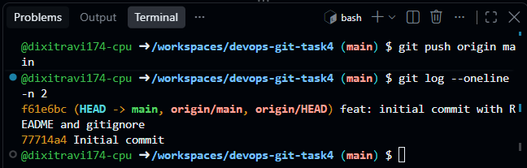
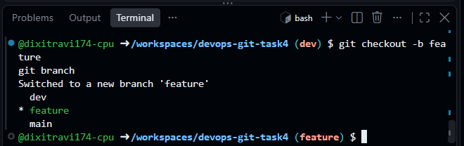
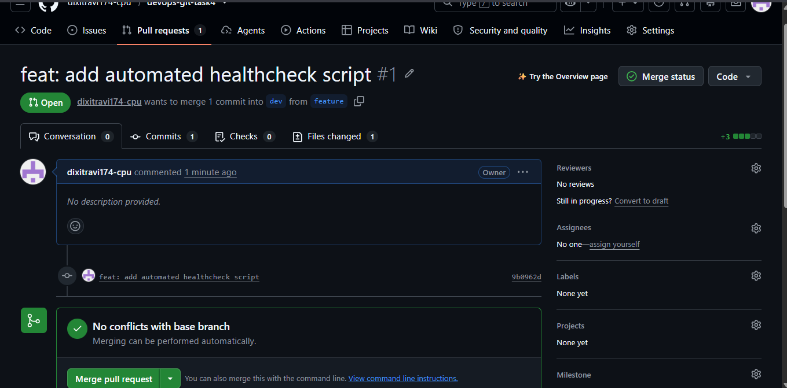
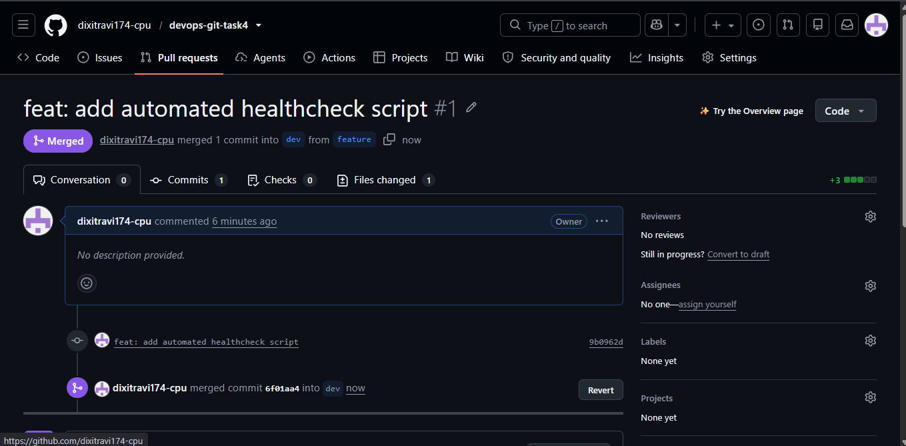
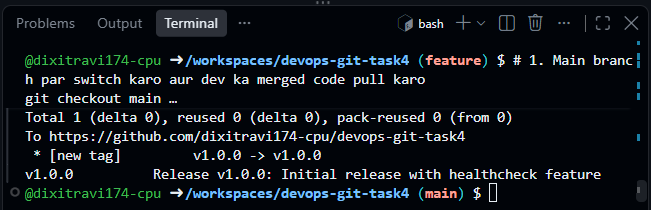

# Elevate Labs DevOps Internship - Task 4
## Version-Controlled DevOps Project with Git & GitHub

### 📌 Project Overview
This project demonstrates industry-standard Git version control workflows, branching strategies, pull requests, tagging, and repository hygiene as part of the Elevate Labs DevOps Internship.

---

### 🌿 Branching Strategy
We implemented a three-tier branching model:
* `main`: Production-ready, stable code.
* `dev`: Staging/development branch where feature branches are integrated.
* `feature`: Isolated branch used to develop new features or scripts.

---

### 🛠️ Step-by-Step Implementation

1. **Repository Initialization & .gitignore:**
   * Initialized repository and configured `.gitignore` to avoid tracking unnecessary logs and environment files.
   * 

2. **Branch Creation (`dev` & `feature`):**
   * Branched `dev` off `main`, then branched `feature` off `dev`.
   * 

3. **Feature Development & Pull Request (PR):**
   * Added `healthcheck.sh` inside the `feature` branch.
   * Raised a Pull Request from `feature` into `dev` branch on GitHub.
   * 

4. **Pull Request Review & Merge:**
   * Successfully reviewed and merged the PR into `dev` branch.
   * 

5. **Release Tagging:**
   * Merged changes to `main` and created annotated release tag `v1.0.0`.
   * 

---

### 📚 DevOps Interview Questions & Answers

#### 1. What is Git?
Git is an open-source, distributed version control system (DVCS) designed to handle projects with speed and efficiency. Every developer maintains a complete local clone of the project history.

#### 2. What is the difference between merge and rebase?
* **`git merge`**: Combines histories of two branches using a new merge commit. It preserves the complete chronological history and branch context.
* **`git rebase`**: Moves or applies feature branch commits on top of the target base branch sequentially, producing a linear, clean commit history.

#### 3. What is a pull request (PR)?
A Pull Request is a GitHub/GitLab collaboration mechanism where a developer notifies team members that a completed feature is ready to be reviewed, discussed, and merged into the target branch.

#### 4. How do you resolve merge conflicts?
* Identify conflicting files flagged by Git (`both modified`).
* Open conflicting files, inspect conflict markers (`<<<<<<<`, `=======`, `>>>>>>>`), and manually choose or reconcile the code.
* Stage resolved files using `git add <file>`.
* Finalize the resolution with `git commit`.

#### 5. What are Git tags?
Git tags are reference pointers to specific points in Git history, primarily used to mark release milestones (e.g., `v1.0.0`, `v2.1.0`) without creating separate branches.

#### 6. What is Git workflow?
A Git workflow is a defined branching and integration strategy (e.g., Gitflow, Trunk-based development, GitHub Flow) that sets team rules for how branches are created, tested, reviewed, and merged into production.

#### 7. Explain git stash.
`git stash` temporarily shelves (shelters) uncommitted working directory changes (both staged and unstaged) so you can work on a different branch with a clean working directory without committing incomplete work. You can restore them later using `git stash pop`.

#### 8. What is the use of .gitignore?
`.gitignore` specifies intentionally untracked patterns/files (such as API keys, `.env` files, build binaries, temporary logs, dependencies like `node_modules/`) that Git should ignore and prevent from being tracked or pushed to remote repositories.
